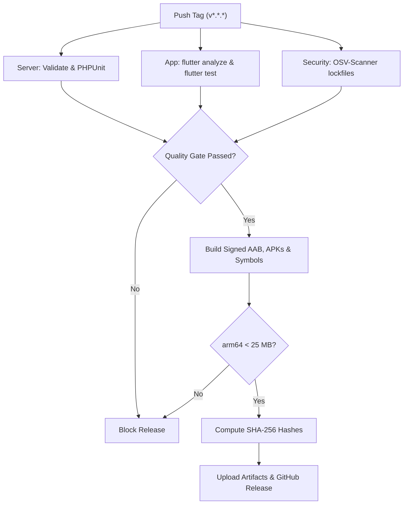

# Release Engineering, Store Readiness & Distribution Guide

This document establishes the release engineering standards, build configuration, signing procedures, store readiness assets, and operational rollout protocols for the **Inventory (የኔ ሱቅ)** mobile application (Flutter) and companion backend (Laravel + SQLite).

---

## 1. Brand & Identity Configuration

| Key | Production Value | Fallback / Development Value |
|---|---|---|
| **APP_NAME (English)** | `Inventory` | `Inventory` |
| **APP_NAME (Amharic)** | `የኔ ሱቅ` (or `ዕቃ ዝርዝር`) | `የኔ ሱቅ` |
| **PACKAGE_ID (applicationId)** | `com.yenesuq.inventory` | `com.yenesuq.inventory` |
| **PRODUCTION_DOMAIN** | `stock.yenesuq.com` | `localhost:8000` |
| **SUPPORT_EMAIL** | `support@yenesuq.com` | `support@yenesuq.com` |
| **SUPPORT_TELEGRAM** | `@yenesuq_support` | `@yenesuq_support` |

> [!CAUTION]
> **CONFIRM BEFORE FIRST PUBLISH**: `com.yenesuq.inventory`, `stock.yenesuq.com`, and `support@yenesuq.com` are the values present in this repository. The task's brand inputs were not supplied. Confirm the package ID before the first Play upload because it is permanent; do not publish a placeholder or unapproved identity.

---

## 2. Versioning & SemVer Strategy

The application follows **Semantic Versioning (SemVer 2.0.0)**:
`MAJOR.MINOR.PATCH` (e.g., `1.0.0`, `1.1.0`, `1.2.1`).

### Rule Definitions
1. **versionName** (`MAJOR.MINOR.PATCH`):
   - Defined in `app/pubspec.yaml` (e.g. `version: 1.0.0+1`) and synchronized with Git release tags (e.g. `v1.0.0`).
   - Also reflected in `server/config/app_release.php` under `'latest'` and `'min_supported'`.
2. **versionCode** (Monotonically increasing integer):
   - Injected dynamically in CI from `${{ github.run_number }}` or via `-PversionCode=N` / `--build-number=N`.
   - Every build submitted to Google Play Console must strictly increment `versionCode`.

### Step-by-Step Version Bump Workflow
1. Update `app/pubspec.yaml`:
   ```yaml
   version: 1.1.0+42
   ```
2. Update `server/config/app_release.php` (or server `.env`):
   ```php
   'latest' => '1.1.0',
   'latest_code' => 42,
   'notes_en' => 'Faster sale checkout and improved customer credit ledger.',
   'notes_am' => 'ፈጣን የሽያጭ መመዝገቢያ እና የተሻሻለ የዱቤ ደብተር።',
   ```
3. Commit and tag the release:
   ```bash
   git commit -am "chore(release): bump version to v1.1.0 (build 42)"
   git tag -a v1.1.0 -m "Release v1.1.0"
   git push origin main --tags
   ```

---

## 3. Architecture & SDK Decisions Record (ADR)

### A. minSdk Decision (minSdkVersion = 24 / Android 7.0)
- **Decision**: Keep Flutter's default when possible, but the resolved `local_auth_android 2.0.8` plugin declares `minSdk = 24`; therefore release minSdk is 24. Gradle uses `maxOf(flutter.minSdkVersion, 24)` so a future Flutter default increase is preserved.
- **Context & Rationale**:
  - The minimum supported Android version is 7.0; older Android 5/6 devices cannot install this build while `local_auth_android 2.0.8` is included.
  - The 32-bit `armeabi-v7a` build remains available for Android 7+ devices with 32-bit processors.
  - Resolved dependency Android build files were checked: `local_auth_android` requires API 24, `flutter_secure_storage` API 23, while notifications/SQLite declare API 21.

### B. targetSdk Decision (targetSdkVersion = 36 / Android 16)
- **Decision**: Target Android 16 (API level 36), with compileSdk = 36.
- **Context & Rationale**:
  - Checked Google's target API policy on 2026-11-06. Since August 31, 2026, new apps and updates must target API 36 or higher. [Google Play target API requirements](https://support.google.com/googleplay/android-developer/answer/11926878?hl=en).
  - Recheck this policy before each Play submission; the requirement changes over time.

### C. Permissions Audit & Security Boundaries
- **Manifest Permissions (`AndroidManifest.xml`)**:
  - `android.permission.INTERNET`: Required only for optional online sync and update checks.
  - `android.permission.POST_NOTIFICATIONS`: Required on Android 13+ for scheduled daily/weekly backup reminders.
  - `android.permission.VIBRATE`: Tactile feedback on notification alert.
  - `android.permission.RECEIVE_BOOT_COMPLETED`: Reschedules backup reminder notifications on phone reboot.
  - `android.permission.USE_BIOMETRIC`: App-lock authentication via `local_auth`.
- **Zero Storage Permissions**:
  - `READ_EXTERNAL_STORAGE`, `WRITE_EXTERNAL_STORAGE`, and `MANAGE_EXTERNAL_STORAGE` are strictly omitted.
  - File exports (.sqlite database backups, CSV reports) use Android's system share sheet (`share_plus`) and Storage Access Framework (SAF), eliminating privacy risk.
- **Cleartext Traffic Disabled**:
  - `android:usesCleartextTraffic="false"` strictly forbids plaintext HTTP traffic. All network requests must use TLS 1.3 / HTTPS.
- **allowBackup Disabled**:
  - `android:allowBackup="false"` is deliberate because backup and restore are handled through the app's explicit export/import flow. This prevents Android Auto Backup from copying the local database implicitly. Do not describe exported backups as encrypted unless the implementation is changed and verified.

---

## 4. Signing & Keystore Management

### Upload Keystore Generation
The upload keystore is generated once and stored outside the source repository:

```bash
keytool -genkeypair \
  -v \
  -keystore upload-keystore.jks \
  -keyalg RSA \
  -keysize 2048 \
  -validity 10000 \
  -alias upload \
  -storetype JKS
```

> [!IMPORTANT]
> **DUAL BACKUP MANDATE**:
> The `upload-keystore.jks` and its passwords MUST be backed up in **two separate, isolated secure storage locations**:
> 1. An organization password vault (e.g. 1Password or Bitwarden).
> 2. An offline, encrypted cold-storage physical drive in a fireproof safe.
>
> **Play App Signing**: The app must be enrolled in Google Play App Signing. Google secures the actual App Signing Key, while our `upload-keystore.jks` signs upload bundles (`.aab`). If the upload key is ever lost, Google Play Support can reset the upload key if identity is verified.

### Local & CI Secrets Injection
- Local developers configure `app/android/key.properties` (strictly gitignored):
  ```properties
  storePassword=YOUR_STORE_PASSWORD
  keyPassword=YOUR_KEY_PASSWORD
  keyAlias=upload
  storeFile=/absolute/path/to/upload-keystore.jks
  ```
- Release builds fail if the release keystore settings are missing. Debug builds remain available for local development; never distribute a debug-signed release artifact.
- In CI (GitHub Actions), secrets are injected from repository secrets:
  - `KEYSTORE_BASE64`: `base64 -w 0 upload-keystore.jks`
  - `KEYSTORE_PASSWORD`
  - `KEY_ALIAS`
  - `KEY_PASSWORD`
  - **Zero Leakage**: CI scripts never echo or print these variables. The release job fails closed if any signing secret is absent.

---

## 5. Build Configuration & Artifact Specifications

Every tagged release produces five distribution artifacts:

| Artifact | File Name | Target Channel | Description |
|---|---|---|---|
| **Play App Bundle** | `app-release.aab` | Google Play Store | Dynamic delivery bundle signed with upload key. |
| **64-bit ARM APK** | `app-arm64-v8a-release.apk` | Direct Download Portal | Optimized for modern smartphones (Samsung, Tecno, Infinix). |
| **32-bit ARM APK** | `app-armeabi-v7a-release.apk` | Direct Download Portal | Optimized for older 32-bit smartphones & Android Go devices. |
| **Universal APK** | `app-release.apk` | Sideload / USB Distribution | Contains all native ABIs for universal offline distribution. |
| **Debug Symbols** | `app-symbols-vX.Y.Z-N.zip` | Internal Archive & Play Console | R8 Proguard mappings and native stack traces for crash de-obfuscation. |

### R8 Shrinking & Code Obfuscation Rules
- Release builds enforce `isMinifyEnabled = true` and `isShrinkResources = true`.
- Proguard rules (`app/android/app/proguard-rules.pro`) preserve:
  - Drift & SQLite reflection hooks (`eu.simonbinder.sqlite3.**`, `org.sqlite.**`).
  - Flutter engine and plugin bindings (`io.flutter.**`).
  - Biometrics and secure storage reflection classes (`androidx.biometric.**`, `de.julianassmann.flutter_secure_storage.**`).
- Obfuscation is enabled with symbol splitting:
  ```bash
  flutter build appbundle --release --obfuscate --split-debug-info=build/symbols
  ```

### Resource & Locale Stripping
- Only supported locales (`en` and `am`) are bundled in the binary:
  ```kotlin
  resourceConfigurations.addAll(listOf("en", "am"))
  ```
- Unused translations from third-party AndroidX libraries are automatically stripped by R8.

### APK Size Budget & Component Analysis
- **Hard Limit**: Keep `app-arm64-v8a-release.apk` strictly under 25 MB (25,000,000 bytes).
- `scripts/build_release_artifacts.sh` blocks a build above the limit and invokes `scripts/report_apk_components.py` to report compressed native library, Flutter asset, DEX, Android resource, and other payload sizes.
- Do not record a measured breakdown until it has been generated from the exact tagged artifact. If native Flutter/SQLite libraries make the threshold impossible, attach the report to the release and document the measured reason here before relaxing the gate.

---

## 6. Continuous Integration (CI) Release Workflow

The automated CI pipeline (`.github/workflows/ci.yml`) runs on GitHub Actions:



### Quality Gates (Blocking)
1. `composer validate --strict` and `composer audit`
2. PHPUnit test suite passing 100%
3. `flutter analyze` passing with zero errors or warnings
4. `flutter test` passing with 100% assertions
5. `google/osv-scanner-action` verifying zero known CVEs in lockfiles

---

## 7. Update Check & Offline Continuity Rule

The application periodically checks for updates without ever disrupting offline business:

### Server Endpoint
`GET /v1/app/version` (Unauthenticated):
```json
{
  "latest": "1.1.0",
  "latest_code": 15,
  "min_supported": "1.0.0",
  "min_supported_code": 1,
  "download_url": "https://stock.yenesuq.com/app/",
  "notes_en": "Speed improvements and bug fixes for Ethiopian shopkeepers.",
  "notes_am": "ፈጣን አሰራር እና ለኢትዮጵያ ሱቆች የተዘጋጁ ማስተካከያዎች።"
}
```

### Client Execution Rules
1. **Frequency Throttle**: At most once every 24 hours when online (`last_update_check_ms`).
2. **Non-Blocking UI**:
   - If an update is available, a clean Material 3 card appears on the Home Screen.
   - The user can tap `"Download Update Now"` or dismiss (`"X"`).
   - Dismissal allows normal navigation across sales, inventory, and reports.
3. **The Offline Guarantee**:
   - `min_supported` may **ONLY pause online sync** if wire protocols diverge.
   - The app **NEVER** displays a blocking modal, paywall, or expiration lockout.
   - Local POS checkout, customer credit tracking, cash drawer, and inventory management remain 100% operational offline forever.

---

## 8. Direct Download & Distribution Portal

Direct download files are hosted under `server/public/app/index.html`:
- Available at `https://stock.yenesuq.com/app/`.
- Bilingual (English and Amharic with one-click switcher).
- One-click download buttons for:
  - `app-arm64-v8a-release.apk` (Recommended)
  - `app-armeabi-v7a-release.apk` (32-bit legacy)
  - `app-release.apk` (Universal)
- Cryptographic SHA-256 hashes listed next to each download button.
- Clear 4-step Android installation guide explaining "Install Unknown Apps".
- Security banner warning merchants to download only from the official domain.

---

## 9. Store Readiness & Marketing Pack

All store assets are maintained under `/store/`:
- `store/listing_en.txt`: English Play Store title, 78-char short description, and full description with feature bullets.
- `store/listing_am.txt`: Amharic listing flagged for native speaker review (`[FLAGGED FOR NATIVE REVIEW]`).
- `store/screenshots_spec.md`: Exact specifications for 8 phone screenshots (1080×1920) generated from `DemoDataService`.
- `store/feature_graphic.png` & `.svg`: 1024×500 feature graphic.
- `store/content_rating.md`: IARC responses (PEGI 3 / Everyone).
- `store/data_safety.md`: Google Play Data Safety answers based on real app behavior.

---

## 10. Pre-Release Smoke Test Checklist

### Upgrade Test from Previous Release
Install the previous production build, create representative products, stock, sales, customer credit, and a backup, then install the new signed APK over it without clearing app data. Confirm all records and pending sync entries remain readable, migrations complete, and the backup can be restored. Repeat on one arm64 and one armeabi-v7a device when available. Record the old/new version, device/Android version, result, and database migration path in the release changelog.

### Changelog
For each tag, add user-facing English and Amharic notes to `server/config/app_release.php`, include notable changes and known limitations in the GitHub release notes, and retain the generated SHA-256 list and CI artifact with the release. Mark Amharic notes for native review before publication.

### Physical Device Smoke Tests

Execute this checklist on a physical device prior to publishing:

- [ ] **1. Clean Install**: APK installs cleanly on a fresh device without crashes.
- [ ] **2. 100% Offline Startup**: Airplane mode enabled; app launches in under 1.5 seconds without network prompts.
- [ ] **3. Demo Seeder & Product Creation**: Load demo products, add custom stockable item, service item, and recipe consumable item.
- [ ] **4. POS Sale Checkout**: Ring up 3 items; tender payment using Cash, Telebirr, and Dube; receipt generates.
- [ ] **5. Customer Dube Ledger**: Open customer profile; verify balance reflects credit sale; record a partial repayment.
- [ ] **6. Multi-Location Stock Transfer**: Transfer 5 units from Warehouse to Main Suq; verify inventory adjustments.
- [ ] **7. Local Database Backup**: Generate backup file (.sqlite); trigger share sheet to Telegram "Saved Messages".
- [ ] **8. App Lock & Biometrics**: Enable PIN / Biometrics in Settings; verify app locks on resume and unlocks properly.
- [ ] **9. Update Banner Check**: Simulate update metadata; verify banner appears non-blockingly and can be dismissed.
- [ ] **10. Online Sync Verification**: (Optional) Pair with Telegram bot; verify outbox flushes and synced changes appear in bot.

---

## 11. Staged Rollout & Emergency Rollback Plan

### Staged Rollout Schedule (Google Play Console)
```
Day 1: 10% Rollout  ──►  Day 3: 50% Rollout  ──►  Day 5: 100% Full Rollout
```
1. **Day 1 (10%)**: Release to 10% of users. Monitor:
   - Google Play Vitals: Crash rate (threshold < 0.2%), ANR rate (threshold < 0.1%).
   - Server error logs: Check for abnormal 4xx/5xx spikes on `/v1/sync`.
   - Telegram support channel (`@yenesuq_support`).
2. **Day 3 (50%)**: If no critical bugs are detected, increase rollout to 50%.
3. **Day 5 (100%)**: Promote to 100% General Availability.

### Emergency Rollback Protocol
If a critical regression occurs (e.g. database migration failure, crash on checkout):

1. **Halt Rollout Immediately**:
   - In Google Play Console: navigate to `Release > Production > Releases > Halt rollout`.
2. **Server-Side Safety Net**:
   - In `server/config/app_release.php` (or server `.env`), set `APP_RELEASE_MIN_SUPPORTED` to the previous known-good version (e.g. `1.0.0`).
   - This immediately prevents problematic newer clients from corrupting backend sync databases without crashing the client's local POS.
3. **Direct Download Rollback**:
   - Keep every previous signed APK and matching checksum file in a versioned archive before replacing current files.
   - Restore the previous signed APKs and matching `SHA256SUMS.txt` on `https://stock.yenesuq.com/app/`.
4. **Issue Hotfix**:
   - Branch `hotfix/vX.Y.Z`, resolve issue, increment `patch` and `versionCode`, tag, and deploy via expedited review.
